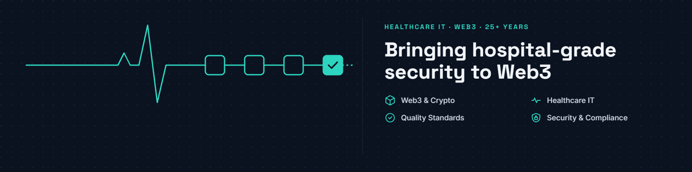

# Hi, I'm Fatih Koçan 👋

**25+ years running IT exclusively in hospitals, where systems can never go down and patient data can never leak. Now I bring that same hospital-grade security mindset to Web3.**

I've managed the full IT infrastructure of private hospitals ranging from 20 to 70 beds and played a key role in healthcare quality accreditation. Today I'm the IT lead at ATA Grup Sağlık, while actively building and contributing in the crypto and Web3 ecosystem.

### 🏥 Healthcare IT
- End-to-end infrastructure: networks, servers, endpoints, backup & disaster recovery
- Hospital Information Systems (HIS), PACS and LIS integrations
- Healthcare quality standards (SKS) and accreditation audits
- Data privacy & compliance (KVKK / GDPR)
- Vendor management, budgeting and IT team leadership

### ⛓️ Web3
- 💻 **Developer:** writing code, scripts and automation for Web3 projects
- 🧪 **Testnet contributor:** testing early-stage protocols, reporting bugs and UX feedback
- 📣 **Community Ambassador:** growing communities, creating content, onboarding new users
- 💡 **Interest:** Web3 for healthcare: decentralized identity, secure medical records, data sovereignty

### 🎯 What I bring
Most Web3 teams are fast. Few have operated systems where failure isn't an option. I combine decades of security, compliance and quality-process discipline with hands-on Web3 experience.

### 📩 Open to
- Web3 roles in infrastructure, security, operations or compliance
- Ambassador & community programs
- Projects bridging blockchain and healthcare

### 🤝 Connect

